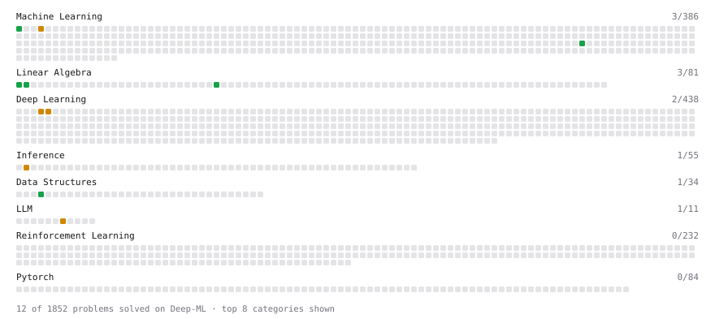

# Deep-ML

My machine learning practice from [Deep-ML](https://www.deep-ml.com). Every solution here was written by hand.

**22** solved · 17 problems · 2 labs · 3 math

[**Browse the interactive portfolio**](https://farhadGithub.github.io/deep-ml/) to replay this filling in over time.

## Problems

| | Difficulty | Solved | |
| --- | --- | --- | --- |
| [Derivative of a Polynomial](https://www.deep-ml.com/problems/116) | easy | 2026-10-24 | [solution](problems/0116-derivative-of-a-polynomial) |
| [Detect Overfitting or Underfitting](https://www.deep-ml.com/problems/86) | easy | 2026-10-30 | [solution](problems/0086-detect-overfitting-or-underfitting) |
| [Dot Product Calculator](https://www.deep-ml.com/problems/83) | easy | 2026-10-24 | [solution](problems/0083-dot-product-calculator) |
| [Label Encoding for Ordinal Variables](https://www.deep-ml.com/problems/356) | easy | 2026-10-17 | [solution](problems/0356-label-encoding-for-ordinal-variables) |
| [Linear Regression Using Normal Equation](https://www.deep-ml.com/problems/14) | easy | 2026-10-28 | [solution](problems/0014-linear-regression-using-normal-equation) |
| [Matrix-Vector Dot Product](https://www.deep-ml.com/problems/1) | easy | 2026-10-17 | [solution](problems/0001-matrix-vector-dot-product) |
| [Random Train/Validation/Test Split with Shuffling](https://www.deep-ml.com/problems/1058) | easy | 2026-10-24 | [solution](problems/1058-random-train-validation-test-split-with-shuffling) |
| [Transpose of a Matrix](https://www.deep-ml.com/problems/2) | easy | 2026-10-24 | [solution](problems/0002-transpose-of-a-matrix) |
| [Direct Preference Optimization (DPO) Loss](https://www.deep-ml.com/problems/382) | medium | 2026-10-28 | [solution](problems/0382-direct-preference-optimization-dpo-loss) |
| [Dropout Layer](https://www.deep-ml.com/problems/151) | medium | 2026-10-30 | [solution](problems/0151-dropout-layer) |
| [Find the Best Gini-Based Split for a Binary Decision Tree](https://www.deep-ml.com/problems/138) | medium | 2026-10-30 | [solution](problems/0138-find-the-best-gini-based-split-for-a-binary-decision-tree) |
| [Implementing Basic Autograd Operations](https://www.deep-ml.com/problems/26) | medium | 2026-10-28 | [solution](problems/0026-implementing-basic-autograd-operations) |
| [K-Means Clustering](https://www.deep-ml.com/problems/17) | medium | 2026-10-29 | [solution](problems/0017-k-means-clustering) |
| [Principal Component Analysis (PCA) Implementation](https://www.deep-ml.com/problems/19) | medium | 2026-10-30 | [solution](problems/0019-principal-component-analysis-pca-implementation) |
| [Roofline Model Analysis for GPU Operations](https://www.deep-ml.com/problems/415) | medium | 2026-10-28 | [solution](problems/0415-roofline-model-analysis-for-gpu-operations) |
| [Single Neuron with Backpropagation](https://www.deep-ml.com/problems/25) | medium | 2026-10-28 | [solution](problems/0025-single-neuron-with-backpropagation) |
| [Vectorized K-Means with Broadcasting](https://www.deep-ml.com/problems/1465) | medium | 2026-10-30 | [solution](problems/1465-vectorized-k-means-with-broadcasting) |

## Labs

| | Difficulty | Solved | |
| --- | --- | --- | --- |
| [PyTorch: Build a Complete Training Loop](https://www.deep-ml.com/labs/13) | easy | 2026-10-21 | [solution](labs/0013-pytorch-build-a-complete-training-loop) |
| [Train a Binary Classifier](https://www.deep-ml.com/labs/23) | easy | 2026-10-18 | [solution](labs/0023-train-a-binary-classifier) |

## Math

| | Difficulty | Solved | |
| --- | --- | --- | --- |
| [Derivatives and Gradients](https://www.deep-ml.com/math-problems/1) | easy | 2026-10-24 | [solution](math/0001-derivatives-and-gradients) |
| [Matrix Basics](https://www.deep-ml.com/math-problems/9) | easy | 2026-10-24 | [solution](math/0009-matrix-basics) |
| [Vector Operations](https://www.deep-ml.com/math-problems/7) | easy | 2026-10-24 | [solution](math/0007-vector-operations) |

---

_This file is regenerated by Deep-ML on every push._
